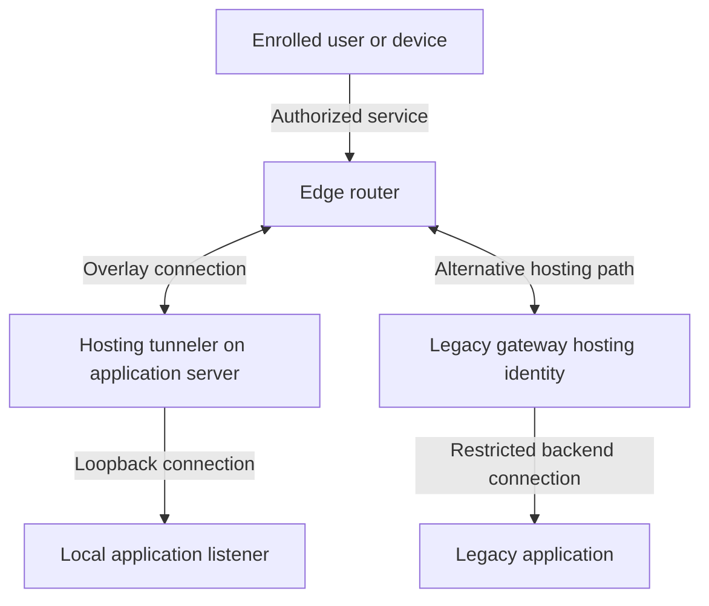

# OpenZiti: Private Application Access with User and Machine Identities

I implemented and tested OpenZiti to give users access to specific applications without granting a general route into the internal network. The work included the controller, administration console, edge router, application hosting, role-based access, and a provisioning script that generated enrollment JWTs and QR codes for phone clients.

Several details needed attention beyond getting the first connection working: separating administrative access from client access, choosing where the hosting tunneler runs, making role assignments predictable, and getting enrollment onto a phone without awkward file handling.

This repository explains those decisions with fictional names and reconstructed examples. It contains no production identities, enrollment tokens, private keys, internal addresses, or employer configurations.

**Start here:** [Implementation guide](IMPLEMENTATION.md) · [Troubleshooting from the deployment](docs/TROUBLESHOOTING.md) · [Onboarding workflow](docs/ONBOARDING.md)

## Why I chose application access over broad network access

The useful difference was the authorization boundary. A user needed permission to reach an application, not membership in an internal network.

| Question | A traditional routed remote-access VPN | This OpenZiti design |
|---|---|---|
| What does the endpoint receive? | Network routes, with access constrained by VPN/firewall policy | Access to explicitly authorized services |
| What identifies the caller? | Often a user/device login associated with a tunnel or assigned IP | An enrolled identity evaluated against service policies |
| What becomes reachable? | Whatever the routes and network rules permit | The configured application address, protocol, and port |
| How is the application reached? | Through a routed network path | Through the overlay to an authorized hosting identity |
| What changes for a new application? | Routes and firewall rules may need updating | Define the service, hosting configuration, and access policies |

A VPN can also use certificates, MFA, device controls, and restrictive firewall rules. The distinction here is the application-oriented design, not a claim that every VPN grants unrestricted access.

OpenZiti supports broad interception too. **The narrow access boundary comes from configuring specific services and policies.** This example does not advertise a subnet or a general-purpose forwarding service. A client tunneler may install local interception routes, but these do not grant general routed access to the application's internal network.

An enrolled identity proves possession of its credentials. Stronger claims about the human or device require the relevant authentication, MFA, external identity provider, or posture policy. Application login and authorization remain in place.

## What I deployed and adjusted

- I used a combined test host for controller, console, and router components.
- I separated the administrative portal from the client-facing port and worked on management API separation.
- I hosted an application through a tunneler on its server, connecting to the local application listener.
- I used role attributes and policies to control application access.
- My Bash provisioning workflow created identities and enrollment JWTs, generated QR images, and delivered enrollment material to users.
- While extending role-to-application discovery, I encountered service IDs appearing where readable names were expected and an application missing from the generated list.

The guide explains the legacy-system alternative: a hosting tunneler or router-hosted tunneling function can connect to an application that cannot run an agent. That changes the final network segment and its security boundary.

## Components and terminology

| Component | Responsibility |
|---|---|
| Controller | Identities, enrollment, authentication, policies, and control-plane coordination |
| Ziti Administration Console (ZAC), called “manager” here | Administrative web UI using controller management APIs |
| Edge router | Carries overlay connections between authorized endpoints |
| Client tunneler | Intercepts configured application traffic on the user's device |
| Hosting tunneler | Binds an authorized service and connects to its backend application |

The manager is not a separate controller role. ZAC can be served by the controller or deployed separately. For production, separate controller/control-plane duties from exposed router/data-plane duties, restrict the administrative interface, and design availability explicitly. Hosting the console on a different VM is optional; a different VM or port alone does not protect the management API.

## Application-hosted and legacy access



The paths are alternatives for a service. The legacy gateway can be a separate host or a function on the router machine. The diagram shows logical roles, not the original deployment.

## What made the deployment more than an installation

Getting an identity enrolled was only the beginning. I confirmed that the enrollment email and its attachments reached the recipient during testing, but also encountered an enrolled laptop that could not resolve an application name. I checked Bind permissions and common routers with the policy advisor, inspected application terminators, and enabled controller event logging. Those checks helped separate delivery, identity, policy, hosting and application problems.

The provisioning workflow also needed readable application names. When I extended discovery, service IDs appeared in the output and an application was missing. The public helper uses an explicit application catalog while the onboarding guide explains what reliable dynamic discovery must resolve.

## Read the repository

| Guide or example | What it covers |
|---|---|
| [Implementation](IMPLEMENTATION.md) | Controller, console, router, hosting, policies and enrollment commands |
| [Multiple applications](docs/APPLICATIONS.md) | Three application roles, service creation and Dial/Bind separation |
| [Onboarding](docs/ONBOARDING.md) | Device identities, QR/JWT delivery, application links and offboarding |
| [Troubleshooting](docs/TROUBLESHOOTING.md) | Actual symptoms, changes and limits of the observed results |
| [Operations](docs/OPERATIONS.md) | Administrative exposure, persistent hosting, events and identity lifecycle |
| [Validation](docs/VALIDATION.md) | Observed results and a deployment acceptance worksheet |
| [Configuration fragments](config/) | Controller/router listeners, event logging and service configurations |
| [Provisioning entry point](scripts/create-user.sh) | Multiple roles, private enrollment bundle and optional email draft |
| [Hosting service](examples/ziti-host.service) | Example systemd unit for a directory of hosting identities |
| [Script tests](tests/test_provision_user.py) | Offline tests using fake CLI tools and synthetic credentials |

The implementation history comes from the 1.6.x era. Start with configuration generated for your supported release and merge the relevant fragments. The public scripts are reconstructions using fictional application names; they contain no original enrollment credentials.

Preview onboarding without contacting a controller:

```bash
bash scripts/create-user.sh sam-laptop portal-users,reports-users \
  --recipient sam@example.com --sender access@example.com
```

Run the offline helper tests:

```bash
python3 -m unittest discover -s tests -v
```

## What I'd tell someone starting this

- My advice is to start with one application and a separate identity for each device, then expand the role model once the whole path is understandable.
- I learned to separate successful enrollment from successful application access. I check both.
- I treat the management API boundary as seriously as the console login page.
- I keep the original identity and service IDs when building readable reports; friendly names are an extra layer.
- I use application-level checks alongside router and terminator status. An online component is useful evidence, but it is not the user's result.
