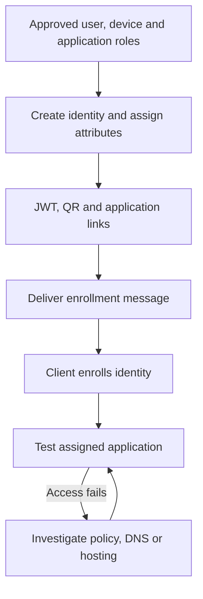

# From an access request to an enrolled device

I built the onboarding workflow because creating an identity in the console was only part of getting someone connected. Users also needed the right application roles, enrollment material they could import, and the URLs they were allowed to use.

My Bash script created the identity and JWT, generated a QR image, and emailed the JWT and QR alongside application links. During testing I checked the mail relay's acceptance and then confirmed that the recipient actually received the attachments. Those were separate checks.

## The workflow I implemented



I also encountered the distinction between enrollment and access directly: a laptop held an enrolled identity, but an application name did not resolve and the links would not open. A successful email and an enrolled identity did not establish that the service path worked.

## A fictional access model

The catalog in [applications.json](../config/applications.json) uses three application roles:

| Identity example | portal-users | reports-users | hosting-users |
|---|---|---|---|
| alex-phone | Yes | No | No |
| sam-laptop | Yes | Yes | No |
| operator-laptop | No | No | Yes |
| portal-host-01 | No: has portal-hosts Bind role instead | No | No |

The catalog is illustrative. It does not disclose the original application names or departmental access rules. A person can have separate phone and laptop identities with different access.

The distinction between a user and a hosting identity matters: end users receive Dial roles; a hosting identity receives only the Bind permissions required for its applications. Access to a hosting-control application does not make an identity an OpenZiti administrator.

The catalog supplies role names, service names, and user-facing URLs. It does not create a service or establish that policy grants are correct.

## Expanded public script

The original workflow was Bash. The public recreation keeps the Bash entry point and uses a small Python standard-library helper to handle multiple roles and MIME attachments reliably.

Prerequisites: Bash, Python 3.9+, a compatible authenticated `ziti` CLI, and `qrencode` for an actual creation. Dependencies must be available before creating an identity.

From the repository root:

```bash
# Preview only; no controller request and no enrollment artifact.
bash scripts/create-user.sh alex-phone portal-users

# Two roles and an optional email draft.
bash scripts/create-user.sh sam-laptop portal-users,reports-users \
  --recipient sam@example.com --sender access@example.com

# Explicitly create in the CURRENT authenticated CLI context.
bash scripts/create-user.sh sam-laptop portal-users,reports-users \
  --recipient sam@example.com --sender access@example.com --apply
```

Before `--apply`, verify the CLI context with a read-only identity/service listing against the intended management endpoint. The script does not switch controller or log in automatically.

An actual run produces a private directory containing:

- `identity.jwt`: enrollment credential.
- `enrollment.png`: QR representation of the same JWT.
- `instructions.txt`: selected applications and enrollment instructions.
- `enrollment.eml`: MIME email draft, when sender and recipient were supplied.

The script does not send mail. Open and review the draft, verify the recipient, then use the organization's approved delivery path. Both attachments and the email draft are sensitive until the token is consumed or expires.

Names and roles are validated; unsupported roles and duplicate identity names stop creation. Creation failures or QR failures leave a clear recovery message rather than automatically deleting an identity. A controller-side creation may have succeeded even when the client reports an error: inspect before retrying.

## What the recipient sees

The generated message follows [this fictional example](../examples/onboarding-email.txt). The application list contains readable labels and HTTPS URLs. It explains that the identity belongs to one device and that the QR and JWT are alternative ways to import the same enrollment.

Use the OpenZiti client's supported import flow, not an arbitrary QR website. Client versions differ in QR/image import support. JWT file import remains the fallback. A QR displayed on the same phone may require image import or a second trusted screen.

An email marked sent means the next mail system accepted it; it is not proof that the user read it, enrolled, or accessed an application.

## The dynamic discovery issue

The original script started with explicit role/application mappings. During later discovery work, the output contained service IDs instead of names and omitted an application.

A dynamic catalog needs these steps:

1. Read all relevant Dial policies, including paginated results.
2. Resolve direct service references to current service objects.
3. Expand service-attribute selectors with their correct matching semantics.
4. Resolve identity selectors and consider all applicable grants.
5. Read the selected service's intercept configuration.
6. Build a readable application link only when its protocol and port imply a meaningful URL; retain explicit overrides for other services.
7. Evaluate router eligibility separately from user authorization.

A string beginning with `@` is not necessarily a friendly application name. Router-policy membership alone is not a Dial grant.

The public script uses an explicit catalog, so it does not pretend to calculate effective access from incomplete discovery logic. After provisioning, inspect the resulting policies and test both permitted and unrelated applications.

## Completing and reversing onboarding

Record the identity, device owner, selected roles, and delivery/enrollment status in an approved inventory. Do not record the raw JWT in routine logs.

For lost devices or offboarding, disable the affected identity through the controller's supported administration path, review other identities belonging to the person, and verify fresh access is denied. Role removal and disabling an identity are different administrative actions. Test existing-session behavior rather than assuming every open connection immediately closes.

Do not reuse one enrolled identity JSON across devices. Replace expired or consumed enrollment material using the supported enrollment/re-enrollment process; creating a second identity simply to avoid investigating the first can leave unwanted access behind.

